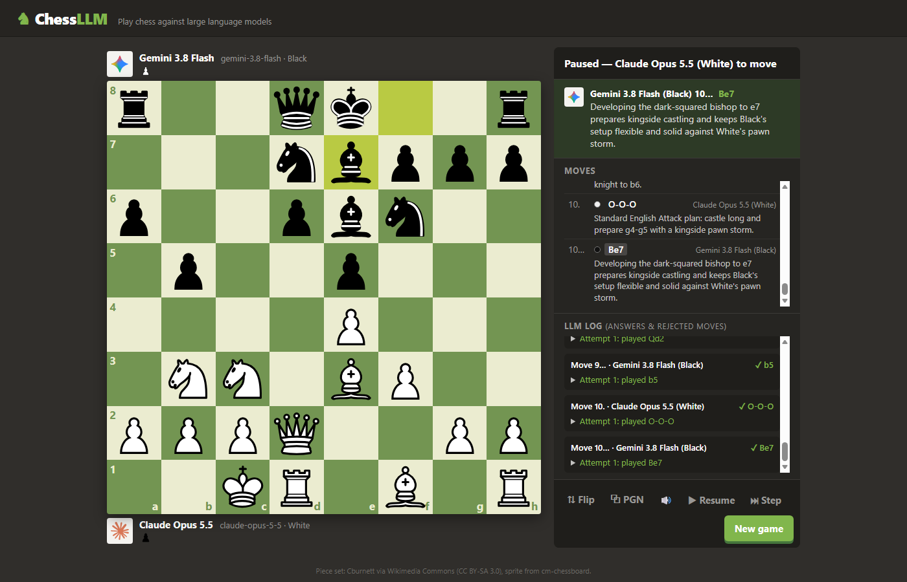

# Chess LLM

A chess.com-style web app where you play chess against large language models, or watch two of them play each other.



*A real game: Claude Opus 5.5 (White) vs Gemini 3.8 Flash (Black), paused after move 10. Each move shows the model's reason; the LLM log lists every attempt.*

- **Play vs LLM**: pick an opponent and a side (white / black / random). Each move comes with a short reason from the model, hidden by default; toggle it with the 💬 Reasons button.
- **LLM vs LLM**: pick a model for each side (the same model may play both) and watch. Reasons are always shown. Pause / resume at any time; while paused, ⏭ Step (or the → key) plays one move at a time.

Any model behind the **Anthropic Messages API** or an **OpenAI-compatible Chat Completions API** works: Claude, GPT, Gemini, DeepSeek, Kimi, OpenRouter, or local models through Ollama / LM Studio / vLLM.

Illegal moves are caught by the server and sent back to the model to try again. Checkmate, stalemate, draws and resignations end the game.

## Prerequisites

| | |
|---|---|
| **Node.js 22.9 or newer** | Check with `node --version`. Download from [nodejs.org](https://nodejs.org) (the LTS version is fine). npm comes with it. |
| **Git** | To clone the repository ([git-scm.com](https://git-scm.com)). You can also download the ZIP from GitHub instead. |
| **At least one LLM API key** | From any provider you want to play against, e.g. [Anthropic](https://console.anthropic.com), [OpenAI](https://platform.openai.com/api-keys), [Google AI Studio](https://aistudio.google.com/apikey), [DeepSeek](https://platform.deepseek.com), [Moonshot](https://platform.moonshot.ai). Or no key at all if you run a local model with [Ollama](https://ollama.com). |
| A modern browser | Chrome, Edge, Firefox or Safari. |

Optional: a [Langfuse](https://langfuse.com) account if you want to trace every LLM call (see [Tracing](#tracing-with-langfuse)).

Calls to paid APIs cost money. A full game is roughly 40 to 80 LLM calls per model, more with reasoning models.

## Quick start

### 1. Get the code and install dependencies

```bash
git clone https://github.com/Nicolfo/chess-llm.git
cd chess-llm
npm install
```

### 2. Add your API keys

Copy the two example files:

```bash
# macOS / Linux / Git Bash
cp .env.example .env
cp config.example.json config.json
```

```powershell
# Windows PowerShell
Copy-Item .env.example .env
Copy-Item config.example.json config.json
```

Open `.env` and fill in the keys for the providers you have, for example:

```ini
ANTHROPIC_API_KEY=sk-ant-...
OPENAI_API_KEY=sk-...
```

`config.json` lists the models shown in the menu and reads each key from `.env` (`"apiKey": "${ANTHROPIC_API_KEY}"`). Remove the models you have no key for, or they will fail when it's their turn to move.

Both `.env` and `config.json` are git-ignored, so your keys are never committed.

### 3. Start the server

```bash
npm start
```

Open **http://localhost:3000**, pick a mode and an opponent, and press **Play**.

Use `npm run dev` instead to restart automatically when you edit the code.

## Configuring opponents

`config.json` holds the list of LLMs shown in the main menu:

```json
{
  "port": 3000,
  "maxAttempts": 5,
  "requestTimeoutMs": 600000,
  "showLegalMoves": false,
  "llms": [
    {
      "id": "opus-5.5",
      "name": "Claude Opus 5.5",
      "provider": "anthropic",
      "baseUrl": "https://api.anthropic.com",
      "apiKey": "${ANTHROPIC_API_KEY}",
      "model": "claude-opus-5-5"
    },
    {
      "id": "llama-local",
      "name": "Llama (local)",
      "provider": "openai",
      "baseUrl": "http://localhost:11434/v1",
      "model": "llama3.1",
      "showLegalMoves": true
    }
  ]
}
```

Top-level settings:

| field | default | |
|---|---|---|
| `port` | `3000` | HTTP port (the `PORT` environment variable wins) |
| `maxAttempts` | `5` | wrong answers in a row before the LLM forfeits the game |
| `requestTimeoutMs` | `600000` | time limit for one LLM call (10 min) |
| `showLegalMoves` | `false` | default for the per-model option below |

Per-model settings:

| field | |
|---|---|
| `id` | unique id (required if you have several entries for the same model) |
| `provider` | `anthropic` (Messages API) or `openai` (Chat Completions API, used for every OpenAI-compatible vendor) |
| `baseUrl` | API root. Anthropic: `https://api.anthropic.com`. OpenAI-style: the URL before `/chat/completions` |
| `apiKey` | `${ENV_VAR}` to read it from `.env` / the environment (recommended), or the literal key |
| `model` | model id sent to the API (required) |
| `name`, `description` | shown in the menu |
| `maxTokens`, `temperature` | optional generation parameters |
| `showLegalMoves` | include the list of legal moves in the prompt (helps small local models) |
| `headers` | extra HTTP headers |
| `extraBody` | merged into the request body, for provider options such as `{ "reasoning_effort": "low" }` |
| `timeoutMs` | per-model override of `requestTimeoutMs` |
| `icon` | avatar: `claude`, `openai`, `gemini`, `kimi`, `deepseek` (files in `public/icons`), an image URL, or `""` for a letter. Guessed from the model, name and URL when omitted |

API keys and base URLs never leave the server; the browser only sees each model's id, name, provider and model.

Other environment variables: `CHESS_LLM_CONFIG=/path/to/file.json` uses another config file, `PORT` overrides the port. If `config.json` is missing, the server falls back to `config.example.json`.

Endpoints used in `config.example.json` (everything except Anthropic goes through the OpenAI-compatible API):

| vendor | provider | baseUrl | models |
|---|---|---|---|
| Anthropic | anthropic | https://api.anthropic.com | claude-opus-5-5, claude-fable-5-1 |
| OpenAI | openai | https://api.openai.com/v1 | gpt-6-astra, gpt-6.1-sol |
| Google | openai | https://generativelanguage.googleapis.com/v1beta/openai | gemini-4-argon, gemini-3.8-flash |
| Moonshot | openai | https://api.moonshot.ai/v1 | kimi-k3 |
| DeepSeek | openai | https://api.deepseek.com | deepseek-v4-pro, deepseek-flash |

## How a turn works

1. You move (drag & drop or click-click). The server validates it with [chess.js](https://github.com/jhlywa/chess.js).
2. The server asks the LLM for its move, sending the FEN, an ASCII board, the PGN move history and your last move.
   The LLM must end its answer with `REASON: <why>` and `MOVE: <move>` (SAN like `Nf3`, `O-O`, `e8=Q`, or UCI like `e2e4`).
   It may resign with `MOVE: resign` when its position is hopeless.
3. The answer is parsed and validated. If there's no move or it's illegal, the server replies in the same
   conversation that the last answer was incorrect, quoting it and giving the reason, and asks again.
4. After `maxAttempts` bad answers the LLM forfeits. Network / API errors don't count: the turn stays with the LLM and the UI offers a Retry button.
5. After every move the server checks for checkmate, stalemate, insufficient material, threefold repetition and the 50-move rule.

The "LLM log" panel lists every attempt, including rejected ones and why.

## Troubleshooting

| problem | fix |
|---|---|
| `node: bad option: --env-file-if-exists` | Node.js is too old. Install 22.9 or newer. |
| An LLM turn fails with `401` / `403` | The key for that provider is missing or wrong in `.env`. Restart the server after editing `.env`. |
| `404` / "model not found" | The `model` id or `baseUrl` is wrong for your account. Check the provider's model list. |
| A reasoning model hits the timeout | Calls aren't streamed, so the model must finish all its thinking first. Raise `timeoutMs` for it, or lower its reasoning effort with `extraBody`. |
| `EADDRINUSE` | Port 3000 is taken. Start with another port: `PORT=3001 npm start` (PowerShell: `$env:PORT=3001; npm start`). |
| Small local model keeps forfeiting | Set `"showLegalMoves": true` for it. |

## Tracing with Langfuse

Optional. Every LLM move can be traced to [Langfuse](https://langfuse.com) (OpenTelemetry-based JS SDK). Tracing stays off unless keys are set. Fill these in `.env` and restart:

```ini
LANGFUSE_PUBLIC_KEY=pk-lf-...
LANGFUSE_SECRET_KEY=sk-lf-...
LANGFUSE_BASE_URL=https://cloud.langfuse.com
```

Trace structure (one trace per LLM move, one session per game):

```
choose-move        agent      input: side, move number, opponent's last move, FEN · output: move + reason (or resigned / forfeit)
├─ generate-move   generation full prompt, answer, reasoning, model, token usage, attempt number
├─ validate-move   guardrail  parsed move -> legal / rejected (WARNING with the reason)
└─ ...             one generate/validate pair per retry
```

- `sessionId` = game id, so the Sessions view replays a whole game; tags `vs-human` / `llm-vs-llm`; metadata `gameId`, `llmId`, `side`, `ply`.
- Token usage is split into cached / reasoning buckets so cost isn't double counted.
- Provider errors mark the generation and the turn as `ERROR`; anything resembling an API key is masked before export.
- `LANGFUSE_TRACING_ENVIRONMENT` sets the environment, `LANGFUSE_RELEASE` the release (defaults to the package version).

The OpenTelemetry packages are pinned to the 2.x line (`sdk-node` 0.223) because `@langfuse/otel` 6 does not yet support OpenTelemetry JS 3.

## For developers

```
src/server.js           Express app + REST API
src/game.js             game state, prompts, retry loop, game-over detection
src/llm.js              Anthropic / OpenAI HTTP clients, traced as generations
src/instrumentation.js  Langfuse / OpenTelemetry setup (imported first)
src/config.js           config loading + ${ENV} expansion
public/                 front-end (vanilla JS, no build step)
```

REST API:

| method | path | body |
|---|---|---|
| GET | `/api/llms` | |
| POST | `/api/games` | `{mode: "human", llmId, color: "white"\|"black"\|"random"}` or `{mode: "watch", whiteLlmId, blackLlmId}` |
| GET | `/api/games/:id` | |
| POST | `/api/games/:id/move` | `{from, to, promotion?}` |
| POST | `/api/games/:id/llm-move` | |
| POST | `/api/games/:id/resign` | |

Games live in memory and are dropped after 6 h idle or on restart. LLM calls use their own undici agent so Node's built-in 300 s fetch limit doesn't cut off long reasoning.

## Credits

- Model logos: [lobehub/icons](https://github.com/lobehub/lobe-icons) (MIT); trademarks belong to their owners.
- Piece images: Cburnett set from Wikimedia Commons (CC BY-SA 3.0), via the cm-chessboard sprite.

## License

[MIT](LICENSE). Bundled third-party assets keep their own licenses (see Credits).
