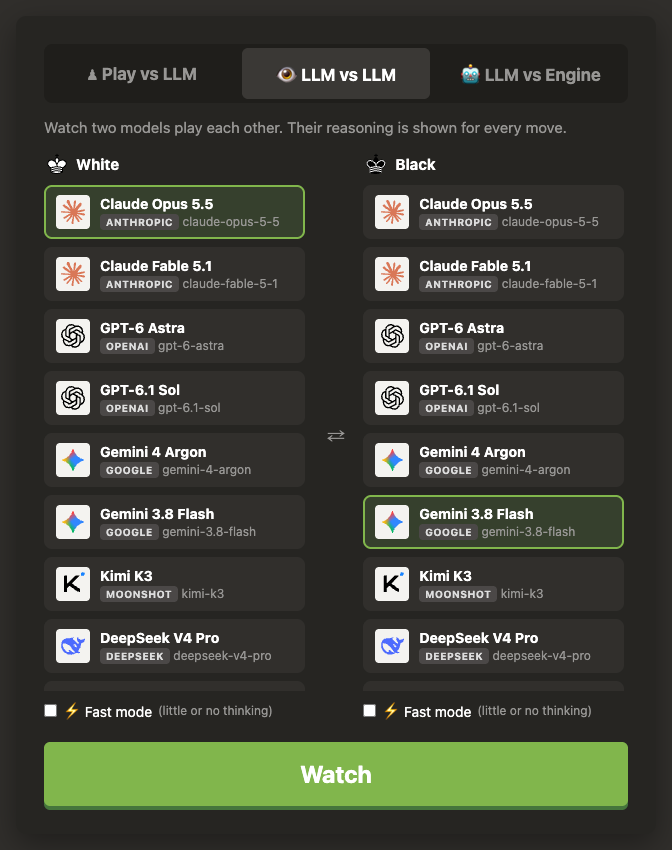
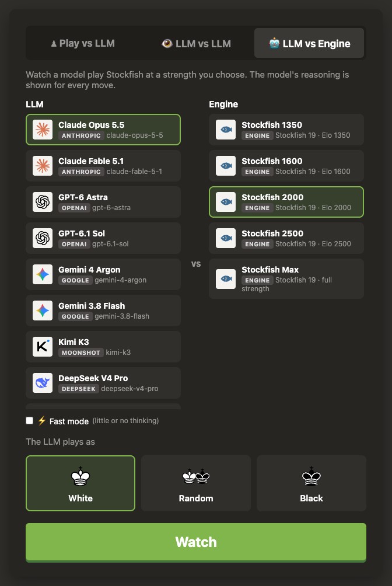

# Chess LLM

A chess.com-style web app where you play chess against large language models, watch two of them play each other, or pit one against Stockfish at a strength you choose.


*A real game: Claude Opus 5.5 (White) vs Gemini 3.8 Flash (Black), paused after move 12. Each move shows the model's reason and Stockfish's verdict; the eval bar, best line and accuracy are on the side.*

- **Play vs LLM**: pick an opponent (an LLM, or Stockfish) and a side (white / black / random). Each move comes with a short reason from the model, hidden by default; toggle it with the 💬 Reasons button.
- **LLM vs LLM**: pick a model for each side (the same model may play both) and watch. Reasons are always shown. Pause / resume at any time (a paused game stays paused when you reopen it); while paused, ⏭ Step (or the → key) plays one move at a time.
- **LLM vs Engine**: its own lobby tab. Pick a model, a Stockfish strength (about 1350 to 2500 Elo, plus full strength) and the model's side, and watch how it holds up against a known level. Stockfish is also in the Play vs LLM list, so you can play it yourself. It runs on the server, needs no API key and costs nothing.
- **Draw offers**: from move 30, each side may offer a draw once every 10 moves: LLMs with a `DRAW: offer` line, Stockfish when the position is equal, you with the ½ Offer draw button (the offer goes with your next move). The opponent accepts, or declines by playing a move. Moves that came with an offer are marked `(=)`.
- **Engine analysis** (📈 Engine): a Stockfish eval bar, the engine's best line, and every move labelled Best / Excellent / Good / Inaccuracy / Mistake / Blunder with an accuracy score per side, like chess.com's game review. Live when watching (LLM vs LLM, LLM vs Engine); when you play, it appears once the game is over. Stockfish runs in your browser, so it costs nothing and needs no setup.
- **Fast mode** (⚡ checkbox under each model pick): the model thinks little or not at all, so moves take seconds instead of minutes, at the cost of weaker play. Thinking is turned off where the provider allows it (DeepSeek, Kimi, Gemini 4 Argon), otherwise set to the lowest effort (Claude, GPT, Gemini 3.8 Flash).

<p align="center">
  
  
</p>

Any model behind the **Anthropic Messages API** or an **OpenAI-compatible Chat Completions API** works: Claude, GPT, Gemini, DeepSeek, Kimi, OpenRouter, or local models through Ollama / LM Studio / vLLM.

Illegal moves are caught by the server and sent back to the model to try again. Checkmate, stalemate, draws and resignations end the game.

## Prerequisites

| | |
|---|---|
| **Docker** | For [Run with Docker](#run-with-docker) (recommended). [Docker Desktop](https://docs.docker.com/get-docker/) on Windows / macOS, Docker Engine on Linux. |
| **or Node.js 22.18+ and Git** | For [Run from source](#run-from-source-nodejs). Check with `node --version`; download from [nodejs.org](https://nodejs.org) (LTS is fine) and [git-scm.com](https://git-scm.com). |
| **At least one LLM API key** | From any provider you want to play against, e.g. [Anthropic](https://console.anthropic.com), [OpenAI](https://platform.openai.com/api-keys), [Google AI Studio](https://aistudio.google.com/apikey), [DeepSeek](https://platform.deepseek.com), [Moonshot](https://platform.moonshot.ai). Or no key at all if you run a local model with [Ollama](https://ollama.com). |
| A modern browser | Chrome, Edge, Firefox or Safari. |

Optional: a [Langfuse](https://langfuse.com) account if you want to trace every LLM call (see [Tracing](#tracing-with-langfuse)).

Calls to paid APIs cost money. A full game is roughly 40 to 80 LLM calls per model, more with reasoning models.

## Run with Docker

The quickest way to start: no Node.js and no need to clone the repo. You only need [Docker](https://docs.docker.com/get-docker/) (Docker Desktop on Windows / macOS) and a `.env` file with your API keys.

A ready-made image is published as `registry.nicolfo.it/nicolfo/chess-llm`. It contains only the app. **Your API keys are not in it**: you pass them in when you start the container.

### 1. Create a folder with your `.env` file (required)

```bash
# macOS / Linux / Git Bash
mkdir chess-llm && cd chess-llm
curl -o .env https://raw.githubusercontent.com/Nicolfo/chess-llm/main/.env.example
```

```powershell
# Windows PowerShell
mkdir chess-llm; cd chess-llm
Invoke-WebRequest https://raw.githubusercontent.com/Nicolfo/chess-llm/main/.env.example -OutFile .env
```

Open `.env` and fill in the key of every provider you want to play against:

```ini
ANTHROPIC_API_KEY=sk-ant-...
OPENAI_API_KEY=sk-...
GEMINI_API_KEY=
MOONSHOT_API_KEY=
DEEPSEEK_API_KEY=
```

Without keys the app starts, but every LLM move fails with an authentication error.

### 2. Choose the models (optional)

By default the image shows the models of [`config.example.json`](config.example.json) (Claude, GPT, Gemini, Kimi, DeepSeek). To change the list, download it as `config.json` into the same folder and edit it (see [Configuring opponents](#configuring-opponents)):

```bash
curl -o config.json https://raw.githubusercontent.com/Nicolfo/chess-llm/main/config.example.json
# PowerShell: Invoke-WebRequest https://raw.githubusercontent.com/Nicolfo/chess-llm/main/config.example.json -OutFile config.json
```

### 3. Start the container

Run this from the folder that contains `.env`. Docker downloads the image the first time.

Default models (`.env` only):

```bash
# macOS / Linux / Git Bash
docker run --rm -p 3000:3000 -v "$PWD/.env:/app/.env:ro" -v chess-llm-data:/app/data registry.nicolfo.it/nicolfo/chess-llm
```

```powershell
# Windows PowerShell
docker run --rm -p 3000:3000 -v "${PWD}/.env:/app/.env:ro" -v chess-llm-data:/app/data registry.nicolfo.it/nicolfo/chess-llm
```

With your own `config.json` from step 2, add a second `-v`:

```bash
docker run --rm -p 3000:3000 -v "$PWD/.env:/app/.env:ro" -v "$PWD/config.json:/app/config.json:ro" -v chess-llm-data:/app/data registry.nicolfo.it/nicolfo/chess-llm
```

Open **http://localhost:3000**. Stop the container with Ctrl+C. To update to the newest version later: `docker pull registry.nicolfo.it/nicolfo/chess-llm`.

What the options do:

| option | |
|---|---|
| `-p 3000:3000` | makes the app reachable on http://localhost:3000. Use `-p 8080:3000` for port 8080 |
| `-v "$PWD/.env:/app/.env:ro"` | gives the container your `.env` (read-only). The app reads it on startup, exactly like `npm start` |
| `-v "$PWD/config.json:/app/config.json:ro"` | replaces the default model list with yours |
| `-e APP_PASSWORD=...` | optional: require a password to open the site (see [Password protection](#password-protection)) |
| `-v chess-llm-data:/app/data` | keeps your games in a Docker volume named `chess-llm-data`, so they survive stopping and updating the container. Leave it out and games are lost when the container stops |
| `--rm` | deletes the container when it stops (the games stay in the volume) |

Common mistakes:

- **`node: .env: invalid format` and the container exits**: `.env` didn't exist at the given path (usually: `docker run` started from another folder), so Docker created an empty `.env` folder there instead. Delete that folder, `cd` into `chess-llm`, check that `ls .env` shows the file, and run again.
- **Editing `.env` or `config.json` while the container runs**: restart the container to apply the changes.
- **`docker run --env-file .env` instead of the `-v` mount**: works only if no value in `.env` is quoted, because Docker keeps the quotes as part of the value.

To build the image yourself instead (e.g. after changing the code), run `docker build -t chess-llm .` in a clone of the repo and use `chess-llm` as the image name in the commands above.

## Run from source (Node.js)

For development, or if you prefer not to use Docker. Needs Node.js 22.18+ and Git.

### 1. Get the code and install dependencies

```bash
git clone https://github.com/Nicolfo/chess-llm.git
cd chess-llm
npm install
```

### 2. Add your API keys

Copy the two example files:

```bash
# macOS / Linux / Git Bash
cp .env.example .env
cp config.example.json config.json
```

```powershell
# Windows PowerShell
Copy-Item .env.example .env
Copy-Item config.example.json config.json
```

Open `.env` and fill in the keys for the providers you have, for example:

```ini
ANTHROPIC_API_KEY=sk-ant-...
OPENAI_API_KEY=sk-...
```

`config.json` lists the models shown in the menu and reads each key from `.env` (`"apiKey": "${ANTHROPIC_API_KEY}"`). Remove the models you have no key for, or they will fail when it's their turn to move.

Both `.env` and `config.json` are git-ignored, so your keys are never committed.

### 3. Start the server

```bash
npm start
```

Open **http://localhost:3000**, pick a mode and an opponent, and press **Play**.

Use `npm run dev` instead to restart automatically when you edit the code.

Games are saved in the `data/` folder (one JSON file per game), so they survive restarts: reload the page and pick up where you left off.

## Configuring opponents

`config.json` holds the LLMs and Stockfish levels shown in the lobby:

```json
{
  "port": 3000,
  "maxAttempts": 5,
  "requestTimeoutMs": 600000,
  "showLegalMoves": false,
  "llms": [
    {
      "id": "opus-5.5",
      "name": "Claude Opus 5.5",
      "provider": "anthropic",
      "baseUrl": "https://api.anthropic.com",
      "apiKey": "${ANTHROPIC_API_KEY}",
      "model": "claude-opus-5-5",
      "fastModeBody": { "output_config": { "effort": "low" } }
    },
    {
      "id": "deepseek-flash",
      "name": "DeepSeek V4.1 Flash",
      "provider": "openai",
      "baseUrl": "https://api.deepseek.com",
      "apiKey": "${DEEPSEEK_API_KEY}",
      "model": "deepseek-flash",
      "thinkingBudget": 16000,
      "fastModeBody": { "thinking": { "type": "disabled" } }
    },
    {
      "id": "llama-local",
      "name": "Llama (local)",
      "provider": "openai",
      "baseUrl": "http://localhost:11434/v1",
      "model": "llama3.1",
      "showLegalMoves": true
    },
    {
      "id": "stockfish-1600",
      "name": "Stockfish 1600",
      "provider": "engine",
      "elo": 1600
    }
  ]
}
```

Top-level settings:

| field | default | |
|---|---|---|
| `port` | `3000` | HTTP port (the `PORT` environment variable wins) |
| `maxAttempts` | `5` | wrong answers in a row before the LLM forfeits the game |
| `requestTimeoutMs` | `600000` | time limit for one LLM call (10 min) |
| `showLegalMoves` | `false` | default for the per-model option below |

Per-model settings:

| field | |
|---|---|
| `id` | unique id (required if you have several entries for the same model) |
| `provider` | `anthropic` (Messages API), `openai` (Chat Completions API, used for every OpenAI-compatible vendor), or `engine` (Stockfish, see below) |
| `baseUrl` | API root. Anthropic: `https://api.anthropic.com`. OpenAI-style: the URL before `/chat/completions` |
| `apiKey` | `${ENV_VAR}` to read it from `.env` / the environment (recommended), or the literal key |
| `model` | model id sent to the API (required) |
| `name`, `description` | shown in the menu |
| `maxTokens`, `temperature` | optional generation parameters (`maxTokens` defaults to 16000 for Anthropic, which requires it; it includes thinking) |
| `showLegalMoves` | include the list of legal moves in the prompt (helps small local models) |
| `headers` | extra HTTP headers |
| `extraBody` | merged into the request body, for provider options such as `{ "reasoning_effort": "low" }` |
| `timeoutMs` | per-model override of `requestTimeoutMs` |
| `fastModeBody` | merged into the request in Fast mode: thinking off, or as low as the model allows. DeepSeek / Kimi: `{ "thinking": { "type": "disabled" } }`; Claude: `{ "output_config": { "effort": "low" } }`; OpenAI / Gemini: `{ "reasoning_effort": "low" }` (`"none"` where supported). Fast mode is offered in the lobby only for models that have it |
| `thinkingBudget` | `openai` provider only: when the model has thought for this many tokens without answering, stop it and ask for the move again in Fast mode, handing over its analysis so far. A safety net against runaway thinking (DeepSeek can think for 5+ minutes on a hard position); set it high enough that normal moves are unaffected, but low enough to be reached before the timeout: thinking streams at roughly 40-60 tokens/s, so `16000` takes about 5 minutes against the default 10-minute `requestTimeoutMs`. Cut-off moves show as warnings in Langfuse |
| `icon` | avatar: `claude`, `openai`, `gemini`, `kimi`, `deepseek`, `stockfish` (files in `public/icons`), an image URL, or `""` for a letter. Guessed from the model, name and URL when omitted |

Stockfish entries (`"provider": "engine"`) need no `model`, `baseUrl` or `apiKey`, and only take these settings besides `id`, `name`, `description` and `icon`:

| field | |
|---|---|
| `elo` | limit the strength to this Elo, `1320` to `3190` (Stockfish's `UCI_Elo`). Calibrated against other engines, so treat it as a rough level rather than a FIDE rating |
| `skillLevel` | instead of `elo`: Stockfish's `Skill Level`, `0` (weakest, below 1320) to `20`. Not calibrated in Elo |
| `movetimeMs` | thinking time per move, default `1000` |

Without `elo` or `skillLevel` the engine plays at full strength. Each move runs its own Stockfish process (the same single-threaded WASM build the browser uses for analysis), so a move takes one CPU core for `movetimeMs`. Engine moves show their evaluation instead of a reason, and are not traced to Langfuse.

API keys and base URLs never leave the server; the browser only sees each model's id, name, provider and model.

Other environment variables: `CHESS_LLM_CONFIG=/path/to/file.json` uses another config file, `PORT` overrides the port, `DATA_DIR` changes where games are saved (default `data/`), and `GAME_RETENTION_DAYS` (default 30, `0` = forever) deletes games nobody has played for that long. If `config.json` is missing, the server falls back to `config.example.json`.

Endpoints used in `config.example.json` (everything except Anthropic goes through the OpenAI-compatible API):

| vendor | provider | baseUrl | models |
|---|---|---|---|
| Anthropic | anthropic | https://api.anthropic.com | claude-opus-5-5, claude-fable-5-1 |
| OpenAI | openai | https://api.openai.com/v1 | gpt-6-astra, gpt-6.1-sol |
| Google | openai | https://generativelanguage.googleapis.com/v1beta/openai | gemini-4-argon, gemini-3.8-flash |
| Moonshot | openai | https://api.moonshot.ai/v1 | kimi-k3 |
| DeepSeek | openai | https://api.deepseek.com | deepseek-v4-pro, deepseek-flash |

> **OpenRouter** works through the `openai` provider with `"baseUrl": "https://openrouter.ai/api/v1"`. Use OpenRouter's model ids (`vendor/model`) and put `OPENROUTER_API_KEY=...` in `.env`:
>
> ```json
> {
>   "id": "or-claude-opus",
>   "name": "Claude Opus 5.5 (OpenRouter)",
>   "provider": "openai",
>   "baseUrl": "https://openrouter.ai/api/v1",
>   "apiKey": "${OPENROUTER_API_KEY}",
>   "model": "anthropic/claude-opus-5-5"
> }
> ```

## How a turn works

1. You move (drag & drop or click-click). The server validates it with [chess.js](https://github.com/jhlywa/chess.js).
2. The server asks the LLM for its move, sending the FEN, an ASCII board, the PGN move history and your last move.
   The LLM must end its answer with `REASON: <why>` and `MOVE: <move>` (SAN like `Nf3`, `O-O`, `e8=Q`, or UCI like `e2e4`).
   It may resign with `MOVE: resign` when its position is hopeless. From move 30 the prompt also lets it offer a draw
   with a `DRAW: offer` line (at most once every 10 moves), and when the opponent has offered one it may accept with `MOVE: accept-draw`;
   playing a move declines.
3. The answer is parsed and validated. If there's no move or it's illegal, the server replies in the same
   conversation that the last answer was incorrect, quoting it and giving the reason, and asks again.
4. After `maxAttempts` bad answers the LLM forfeits. Network / API errors don't count: the turn stays with the LLM and the UI offers a Retry button.
5. After every move the server checks for checkmate, stalemate, insufficient material, threefold repetition and the 50-move rule.

The "LLM log" panel lists every attempt, including rejected ones and why.

## Password protection

Off by default. Set `APP_PASSWORD` and every page and API call requires logging in first (a 30-day HttpOnly cookie; changing the password logs everyone out). `/logout` ends the session.

| variable | |
|---|---|
| `APP_PASSWORD` | enables the login page |
| `COOKIE_SECURE` | `true` to mark the cookie Secure (set it when served over https) |
| `TRUST_PROXY` | `true`, a hop count, or proxy addresses: take the client IP from `X-Forwarded-For` (used to rate-limit wrong passwords) |

## Deploy to Kubernetes

A Dockerfile and a Helm chart (`helm/`) are included.

```bash
# 1. Build and push the image
docker build -t registry.example.com/chess-llm:1.1.0 .
docker push registry.example.com/chess-llm:1.1.0

# 2. API keys: copy the example and fill it in (git-ignored)
cp helm/values-secret.example.yaml helm/values-secret.yaml

# 3. Install (set the image and host in helm/values.yaml or with --set)
helm upgrade --install chess-llm ./helm -n chess-llm --create-namespace -f helm/values-secret.yaml

# 4. Create the login password; the pod waits for this secret before starting
kubectl create secret generic chess-llm-auth -n chess-llm --from-literal=password='<password>'
```

The models list lives under `config` in `helm/values.yaml`. Set `auth.enabled: false` to run without a password.
Games are saved on a 1 Gi volume (`persistence` in `helm/values.yaml`, storage class `local-path`), which is kept even if you `helm uninstall`. The chart runs a single replica because games are also cached in memory and the volume is ReadWriteOnce.

## Troubleshooting

| problem | fix |
|---|---|
| `node: bad option: --env-file-if-exists`, or `Unknown file extension ".ts"` | Node.js is too old. Install 22.18 or newer. |
| An LLM turn fails with `401` / `403` | The key for that provider is missing or wrong in `.env`. Restart the server after editing `.env`. |
| `404` / "model not found" | The `model` id or `baseUrl` is wrong for your account. Check the provider's model list. |
| A reasoning model hits the timeout | Calls aren't streamed, so the model must finish all its thinking first. Raise `timeoutMs` for it, or lower its reasoning effort with `extraBody`. |
| `EADDRINUSE` | Port 3000 is taken. Start with another port: `PORT=3001 npm start` (PowerShell: `$env:PORT=3001; npm start`). |
| Small local model keeps forfeiting | Set `"showLegalMoves": true` for it. |

## Tracing with Langfuse

Optional. Every LLM move can be traced to [Langfuse](https://langfuse.com) (OpenTelemetry-based JS SDK). Tracing stays off unless keys are set. Fill these in `.env` and restart:

```ini
LANGFUSE_PUBLIC_KEY=pk-lf-...
LANGFUSE_SECRET_KEY=sk-lf-...
LANGFUSE_BASE_URL=https://cloud.langfuse.com
```

Trace structure (one trace per LLM move, one session per game):

```
choose-move        agent      input: side, move number, opponent's last move, FEN, pending draw offer · output: move + reason, drawOffered (or resigned / acceptedDraw / forfeit)
├─ generate-move   generation full prompt, answer, reasoning, model, token usage, attempt number
├─ validate-move   guardrail  parsed move -> legal / rejected (WARNING with the reason)
└─ ...             one generate/validate pair per retry
```

- `sessionId` = game id, so the Sessions view replays a whole game; tags `vs-human` / `llm-vs-llm` / `vs-engine`; metadata `gameId`, `llmId`, `side`, `ply`.
- Token usage is split into cached / reasoning buckets so cost isn't double counted.
- Provider errors mark the generation and the turn as `ERROR`; anything resembling an API key is masked before export.
- `LANGFUSE_TRACING_ENVIRONMENT` sets the environment, `LANGFUSE_RELEASE` the release (defaults to the package version).

The OpenTelemetry packages are pinned to the 2.x line (`sdk-node` 0.223) because `@langfuse/otel` 6 does not yet support OpenTelemetry JS 3.

## For developers

```
src/server.ts           Express app + REST API
src/game.ts             game state, prompts, retry loop, game-over detection
src/llm.ts              Anthropic / OpenAI HTTP clients, traced as generations
src/engine.ts           Stockfish as a player (one UCI process per move)
src/instrumentation.ts  Langfuse / OpenTelemetry setup (imported first)
src/config.ts           config loading + ${ENV} expansion
src/auth.ts             optional password login (APP_PASSWORD)
src/store.ts            saved games (one JSON file per game in DATA_DIR)
public/engine.js        Stockfish (WASM) in a Web Worker, eval and move classification
helm/                   Helm chart; Dockerfile at the root
public/                 front-end (vanilla JS, no build step)
```

The server is TypeScript that Node runs directly (it strips the types), so there is no build step. That allows only syntax that can simply be erased: no `enum`, `namespace` or constructor parameter properties, and relative imports end in `.ts`. The front-end stays plain JavaScript, type-checked through JSDoc. `npm run typecheck` checks both (server in strict mode); run `npm install` first, it needs the dev dependencies.

REST API:

| method | path | body |
|---|---|---|
| GET | `/api/llms` | |
| POST | `/api/games` | `{mode: "human", llmId, color: "white"\|"black"\|"random"}` or `{mode: "watch", whiteLlmId, blackLlmId}`. An id ending in `:fast` picks that model in Fast mode |
| GET | `/api/games/:id` | |
| POST | `/api/games/:id/move` | `{from, to, promotion?, offerDraw?}` |
| POST | `/api/games/:id/accept-draw` | (accepts the LLM's pending draw offer) |
| POST | `/api/games/:id/llm-move` | |
| POST | `/api/games/:id/pause` | `{paused: true}` or `{paused: false}` (LLM vs LLM only) |
| POST | `/api/games/:id/resign` | |

Games are saved as one JSON file per game (`src/store.ts`, written atomically after every move) and loaded on demand, so a restart loses nothing; a move that was being thought about when the server stopped is simply asked again. LLM calls use their own undici agent so Node's built-in 300 s fetch limit doesn't cut off long reasoning.

## Credits

- Model logos: [lobehub/icons](https://github.com/lobehub/lobe-icons) (MIT); trademarks belong to their owners.
- Piece images: Cburnett set from Wikimedia Commons (CC BY-SA 3.0), via the cm-chessboard sprite.
- Analysis engine: [Stockfish](https://stockfishchess.org) 19 compiled to WebAssembly by [stockfish.js](https://github.com/nmrugg/stockfish.js) (GPL-3.0). It is served unmodified from the `stockfish` npm package as a separate program; its license is in `node_modules/stockfish/Copying.txt`.

## License

[MIT](LICENSE). Bundled third-party assets keep their own licenses (see Credits).
